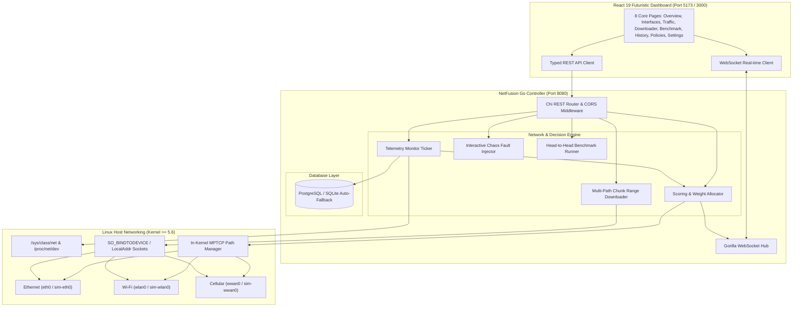

# NetFusion — Intelligent Multi-Network Traffic Controller

[](https://golang.org)
[](https://react.dev)
[](https://www.typescriptlang.org)
[](https://multipath-tcp.org)
[](https://kubernetes.io)
[](https://docker.com)
[](LICENSE)

**NetFusion** is a production-grade, next-generation Linux multi-interface traffic controller. It combines and dynamically aggregates traffic across multiple network interfaces (Wi-Fi, Ethernet, and cellular connections) using native **Linux Multipath TCP (MPTCP)**, per-interface socket multiplexing (`SO_BINDTODEVICE`), and dynamic multi-path chunk range downloading.

---

## Architecture Overview



---

## Key Features

1. **Native Linux MPTCP Integration**: Inspects and controls native Linux kernel MPTCP subflows (`/proc/sys/net/mptcp/enabled`, in-kernel path manager, `ip mptcp endpoint`).
2. **Dynamic Weight Allocation**: Continuously scores interfaces based on RTT latency, jitter, packet loss, stability, and cellular data consumption caps.
3. **Sub-Second Failover & Recovery**: Instantly redirects 100% of traffic away from failing interfaces to surviving paths upon link degradation or disconnect.
4. **Multi-Network Range Chunk Downloader**: Slices files into concurrent byte ranges fetched simultaneously across separate interfaces using Linux socket binding (`SO_BINDTODEVICE` / `LocalAddr`).
5. **Head-to-Head Comparative Benchmark**: Conducts live, side-by-side performance benchmarks (Single Baseline vs Multi-Network Aggregated) showing throughput gain (+X%) and failover duration.
6. **Clean Separation: Real Mode vs Simulation Mode**:
   - **Real Mode**: Reads physical Linux network cards (`eth0`, `wlan0`, `wwan0`) and native kernel MPTCP endpoints.
   - **Simulation Mode**: Simulates realistic multi-network links with an interactive Chaos Injector (sever links, inject latency spikes, drop packets).
7. **Production Storage with Zero-Config Fallback**: Connects to PostgreSQL in production and automatically falls back to an embedded zero-config SQLite database for frictionless local development.

---

## Quickstart Guide

### Option 1: Instant Local Development (Recommended)

Requires **Go 1.24+** and **Node.js 22+**:

```bash
# 1. Clone repository
git clone https://github.com/quintusjonath-jemy/NetFusion.git
cd NetFusion

# 2. Run the concurrent development launcher
./scripts/dev.sh
```

Or run manually in separate terminals:

```bash
# Terminal 1: Backend (Embedded SQLite + Simulation Mode)
cd backend
PORT=8080 SIMULATION_MODE=true DB_DRIVER=sqlite go run ./cmd/server/main.go

# Terminal 2: Frontend Dashboard
cd frontend
npm install
npm run dev
```

Visit **`http://localhost:5173`** in your browser.

---

### Option 2: Full Stack with Docker Compose

Runs PostgreSQL, the Go backend in `hostNetwork` mode with `NET_ADMIN` capabilities, and the React frontend via Nginx:

```bash
docker compose -f deploy/docker/docker-compose.yml up --build -d
```

- **Frontend Dashboard**: `http://localhost:3000`
- **Backend API & WebSocket**: `http://localhost:8080`
- **PostgreSQL**: `localhost:5432`

---

### Option 3: Kubernetes DaemonSet Deployment

NetFusion runs as a Kubernetes **DaemonSet** with `hostNetwork: true` and `CAP_NET_ADMIN` so it can directly inspect node-level physical interfaces and kernel MPTCP subflows:

```bash
# Deploy PostgreSQL, Backend DaemonSet, and Frontend
kubectl apply -k deploy/k8s/
```

Verify deployment:
```bash
kubectl get daemonset,pods,svc -l app.kubernetes.io/part-of=netfusion
```

---

## Linux Native MPTCP Configuration

To enable native Linux MPTCP on your host system:

```bash
# Run the automated helper script as root
sudo ./scripts/setup_mptcp.sh
```

Or configure manually:

```bash
# 1. Enable Linux kernel MPTCP
sudo sysctl -w net.mptcp.enabled=1
sudo sysctl -w net.mptcp.pm_type=0 # 0 = In-kernel Path Manager

# 2. Configure subflow and address announcement limits
sudo ip mptcp limits set subflow 4 add_addr_accepted 4

# 3. Register your physical interfaces as MPTCP endpoints
sudo ip mptcp endpoint add 192.168.1.150 dev eth0 subflow id 1
sudo ip mptcp endpoint add 192.168.2.180 dev wlan0 subflow id 2

# 4. Inspect registered endpoints
ip mptcp endpoint show
```

---

## REST API Reference

| Method | Endpoint | Description |
| :--- | :--- | :--- |
| `GET` | `/healthz` | System health, MPTCP status, and simulation mode flag |
| `GET` | `/api/networks` | List all discovered interfaces with real-time metrics |
| `GET` | `/api/networks/{id}` | Single interface details and historical telemetry |
| `GET` | `/api/metrics` | Historical timeseries telemetry query (`?interface=...&minutes=...`) |
| `GET` | `/api/traffic` | Dynamic bandwidth allocation and active subflow weights |
| `GET` | `/api/downloads` | List active and completed download sessions |
| `POST` | `/api/downloads` | Launch multi-network chunk range download |
| `POST` | `/api/downloads/{id}/stop`| Cancel ongoing download session |
| `GET` | `/api/benchmarks` | Retrieve head-to-head benchmark run history |
| `POST` | `/api/benchmarks` | Trigger comparative performance benchmark test |
| `GET` | `/api/policies` | List traffic allocation policies |
| `POST` | `/api/policies/{id}/activate` | Switch active allocation policy |
| `GET` | `/api/events` | Network audit events timeline (`?limit=...`) |
| `GET` | `/api/settings` | Operational system settings and MPTCP diagnostics |
| `PUT` | `/api/settings` | Update settings (toggle simulation mode) |
| `POST` | `/api/simulation/chaos` | Interactive chaos fault injection (`disconnect`, `degrade`, `spike`, `restore`, `reset`) |
| `GET` | `/ws` | Real-time WebSocket event stream |

---

## WebSocket Events Protocol

Connect to `ws://localhost:8080/ws` to receive continuous, real-time telemetry frames:

- `network_update`: Broadcasts updated latency, loss, and status for all interfaces.
- `traffic_update`: Broadcasts updated normalized weight allocations and aggregate Mbps.
- `network_event`: Immediate alerts for `failover`, `rebalance`, `degraded`, or `recovered` state transitions.
- `download_progress`: Real-time byte progress, aggregate speed, ETA, and per-interface byte contributions.
- `benchmark_progress`: Real-time stage progress during comparative speed testing.

---

## Verification & Testing

### Backend Unit & Race Tests
```bash
cd backend
go test -v -race ./...
```

### Frontend Production Build
```bash
cd frontend
npm run build
```

---

## License

This project is licensed under the [MIT License](LICENSE).
